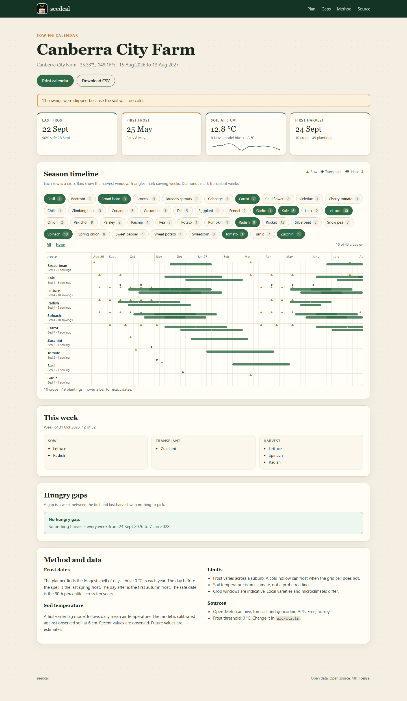
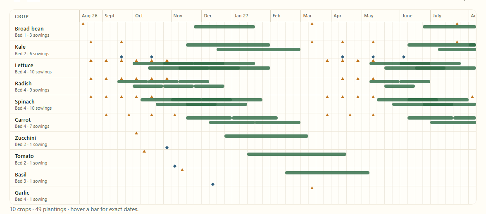
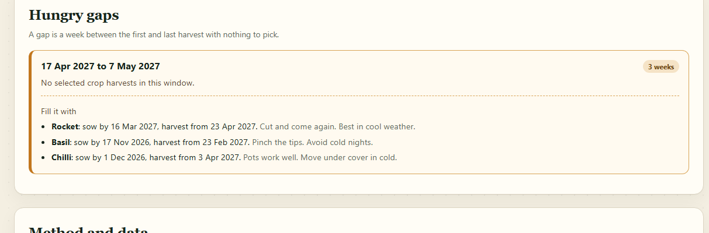
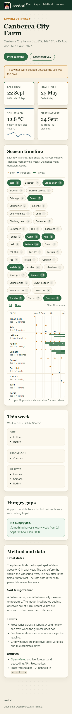

# seedcal

A week-by-week sowing calendar for community gardens. It uses site frost dates and soil temperature.

[](LICENSE)
[](test)
[](package.json)

Seed packets give broad climate zones. The last frost and the soil temperature change from site to site and from year to year. Gardeners sow early and lose seed. Then the harvest arrives in bursts, and the beds sit empty in between.

`seedcal` reads ten years of free weather data for one site. It computes the frost dates and the soil temperature curve. It then builds a 52-week plan of sowings, transplants and harvests for your beds. It names the weeks with nothing to pick and suggests crops that fill them.

## Features

- **Site frost dates.** The planner finds the last spring frost and the first autumn frost in each of ten years. It reports the median date and the 90% safe date.
- **Soil temperature at 6 cm.** A calibrated lag model turns daily air temperature into a soil curve. Recent days use observed values. Future days are marked as estimates.
- **A full season plan.** The planner places 40 common crops in up to six successions per window. It respects frost dates, soil minimums and bed count.
- **Hungry gap finder.** The planner lists each week with no harvest and names catalog crops that cover it.
- **Exports.** Download the plan as CSV, or print a landscape calendar for the shed wall.
- **Offline PWA.** The web app has no runtime dependency. It keeps working after the first load.

## Quick start

You need Node 20 or later.

```bash
npm install
npm run demo      # build web/data/plan.json from the cached Canberra climate file
npm run serve     # http://127.0.0.1:8080/
```

The demo runs offline. It reads `data/climate-canberra.json` and never calls the network.

To build a plan for your own site:

```bash
npm run build
node dist/cli.js search "Bega"
node dist/cli.js fetch --lat -36.67 --lon 149.84 --name "Bega Community Garden" --out data/bega.json
node dist/cli.js plan --cache data/bega.json --beds 6 --out web/data/plan.json
```

To see the gap finder, build the narrow demo:

```bash
npm run demo:gaps   # writes web/data/plan-gaps.json
npm run serve
```

Then open <http://127.0.0.1:8080/?plan=plan-gaps>. Four crops leave a three-week gap in April. The gap panel names rocket, basil and chilli as fillers.

Other commands:

```bash
npm test           # 25 tests with node:test
npm run typecheck  # TypeScript check
node dist/cli.js export --plan web/data/plan.json --out plan.csv
node dist/cli.js crops
```

## Screenshots

The full plan for Canberra City Farm in August. The timeline shows harvest bars, sowing triangles and transplant diamonds.



The season timeline alone. Each row is a crop. The crop filter sits above it.



The hungry gap panel for the narrow crop set. It names the gap and three filler crops.



The same page on a phone at 390 px. The layout stacks in one column.



Screenshots come from the build in this repository. To capture them again, start Chrome with `--remote-debugging-port=9222`, serve the app, then run `node scripts/shots.mjs http://127.0.0.1:8080/`.

## Data sources

| Source | Use | Key |
| --- | --- | --- |
| [Open-Meteo Archive API](https://open-meteo.com/en/docs/historical-weather-api) | Ten years of daily minimum and mean air temperature | None |
| [Open-Meteo Forecast API](https://open-meteo.com/en/docs) | Hourly soil temperature at 6 cm for recent days | None |
| [Open-Meteo Geocoding API](https://open-meteo.com/en/docs/geocoding-api) | Site search by name | None |

All three sources are free and need no key. The archive request caches to a JSON file. Later runs work offline.

The crop catalog ships with the tool. Windows, soil minimums and harvest lengths are indicative values for a temperate climate. Check them against your local seed supplier.

## Method limits

- Frost varies across a suburb. A cold hollow can frost when the weather grid cell does not.
- Soil temperature is a model estimate, not a probe reading. The interface labels it as one.
- Crop windows are indicative. Local varieties and microclimates differ.
- The archive data covers a grid cell of about 1 to 11 km, not your exact bed.

## License

MIT. See [LICENSE](LICENSE).